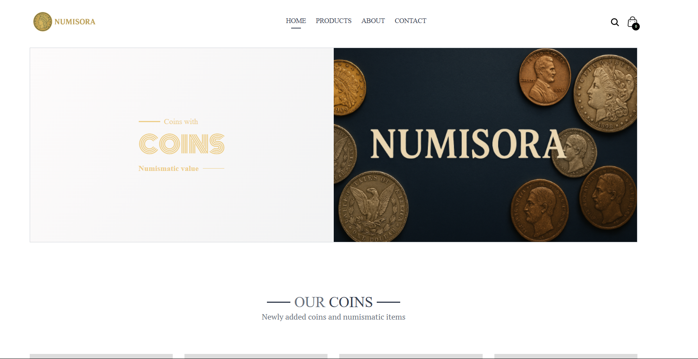

# Numisora – Online Numismatic Coin Shop 🪙

## 📜 Overview

**Numisora** is an innovative online platform designed for collectors and enthusiasts of coins with numismatic value. The project combines modern technologies with a passion for history, providing users the ability to explore, buy, sell, and learn detailed information about rare and valuable coins. 



## 🚀 Features

- **Responsive User Interface 📱💻**: Design optimized for desktop, tablet, and mobile devices.
- **Comprehensive Coin Catalog 🔍**: Search and filter coins by country, year, metal, denomination, and price.
- **Detailed Coin Pages 📖**: Complete coin information and high-quality images for each item.
- **Authentication and Security 🔐**: Secure user registration and login with JWT and password encryption.
- **Inventory Management 📦**: Full CRUD operations for managing coin listings.
- **Interactive UI/UX 🌟**: Modern and appealing design built with React, Tailwind CSS, and Ant Design.
- **Coin Listings 📄**: Display detailed information about coins with numismatic value.
- **CRUD Operations ❌**: Add, edit, and delete coin listings.

## 🛠️ Technologies Used

### 🖥️ Frontend

- **React** – JavaScript library for building dynamic user interfaces using components.
- **Tailwind CSS** – Utility-first CSS framework for responsive and consistent styling.
- **Ant Design** – UI library with ready-made, professional components for React.
- **React Router DOM** – Enables navigation between views without reloading the page.
- **Vite** – Fast build tool and development server for modern frontend frameworks.
- **Jest** – JavaScript testing framework for writing and running unit tests.
- **Axios** – HTTP client for making asynchronous API requests.
- **React Context API** – Built-in state management solution for sharing data across components.
- **React Hook Form & Zod** – Lightweight form management and schema-based validation system.

### 🛠️ Backend

- **Node.js** – Runtime environment for executing JavaScript code server-side.
- **Express.js** – Minimal and flexible Node.js web application framework.

### Database
- **PostgreSQL** (Relational database for storing coins and user information)

### Additional Tools
- **Cloudinary** (SaaS company providing cloud media management services)
- **React Router** (For client-side routing)
- **Git & GitHub** (Commits, push, Fetch, Merge, Pull operations)
- **Local Storage** (Not hosted yet; 🔜Hosting comming soon)

## 💻 Project Structure

```
/📁public
  └── index.html

/📁src 
  ├── 📁 Assets/             # Images, icons, and static assets used in the app
  ├── 📁 Contexts/           # React Context API for managing global state across components
  ├── 📁 components/         # Reusable UI components (e.g., Navbar, Footer, buttons)
  ├── 📁 hooks/              # Custom React hooks (e.g., useApiRequest for handling API calls)
  ├── 📁 pages/              # Main page components corresponding to routes (e.g., Home, Products, Cart)
  ├── 📁 styles/             # Global CSS stylesheets and Tailwind configurations
  ├── 💜App.jsx              # Main application component
  ├── 💜App.css              # Styles for the App component
  ├── 💜main.css             # Main styles file for the project frontend 
  └── 💜index.jsx            # Entry point of the app
```

## ⚙️ Installation

### Frontend

```bash
cd client
npm install
npm run dev
```

### Backend

```bash
cd backend
npm install
npm run start
```

## 🚦 Usage

Open your browser and navigate to [http://localhost:3000](http://localhost:3000). Explore the coin catalog, use filters to find desired items, and enjoy secure authentication and profile management.

## 🌟 Contributing

1. Fork the repository.
2. Create a new branch:
```bash
git checkout -b feature/your-feature
```
3. Commit your changes:
```bash
git commit -m "Your description"
```
4. Push your branch:
```bash
git push origin feature/your-feature
```
5. Create a pull request.

## 📜 License

This project is licensed under the [MIT License](LICENSE).

## 📞 Contact

- **Project Maintainers:** [Georgie Zarev](https://github.com/GeorgiZarev), [Dilyan Yanev](https://github.com/Dilyannn)
- **Email: ✉️** [georgi.zarev0304@gmail.com](mailto:georgi.zarev0304@gmail.com), [dilyanyanev365@gmail.com](mailto:dilyanyanev365@gmail.com)
- **GitHub Repository:** [Numisora](https://github.com/GeorgiZarev/Numismatic)
